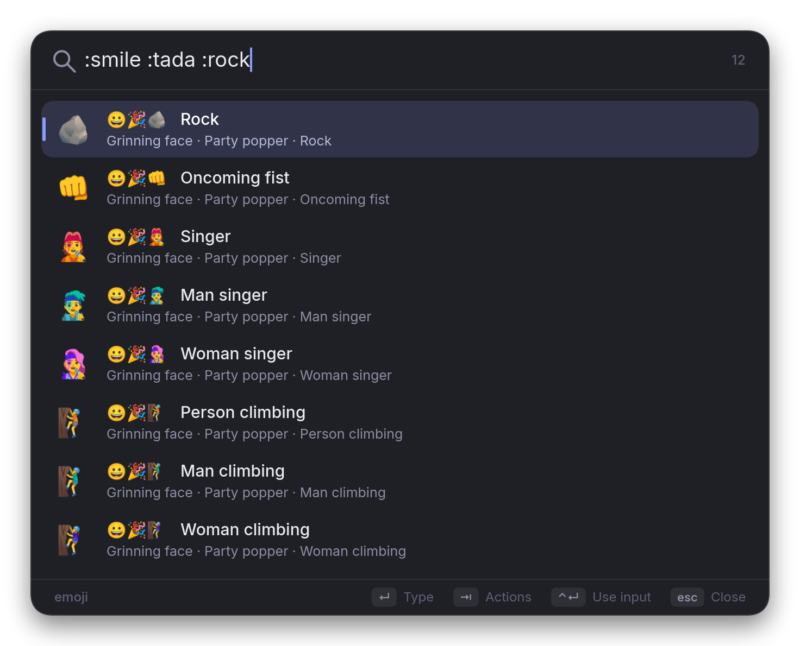

# doit

A rofi for the next millennium: a native Wayland launcher that speaks
structured items instead of strings.

<p>
   
</p>

- **Fast:** Rust, no toolkit, about 18 ms to the first frame.
- **Items, not lines:** titles, subtitles, icons, badges and actions as JSON.
  Plain lines still work, so it is a drop-in dmenu.
- **Live providers:** any executable can answer every keystroke, and keep the
  list up to date while it's open.
- **Looks good out of the box,** with fractional scaling, emoji, icon themes
  and four themes that follow your light or dark preference.

```sh
cargo build --release
install -Dm755 target/release/doit ~/.local/bin/doit
doit                  # apps
ls | doit             # dmenu
```

Needs a compositor with `wlr-layer-shell` (niri, sway, Hyprland, river, KDE,
COSMIC, …).

## Modes

Type a prefix to switch mode; backspace leaves it.

| prefix | mode | |
|---|---|---|
| | apps | desktop applications, ranked by use |
| `=` | calc | live results as you type |
| `:` | emoji | in your language; `:smile :tada :rocket` types several |
| `!` | power | lock, suspend, reboot, … |
| `w ` | niri windows | live window list, also as Alt+Tab |
| `m ` | melody | a remote for [Melody](https://github.com/carnager/melody) |
| `v ` | popcorn | a poster grid for [Popcorn](https://github.com/carnager/cinnamon) |
| `j ` | jot | capture and tick off [Jot](https://github.com/carnager/jot) notes |



The modes live in [`providers/`](providers). To use them, copy them and the
example config:

```sh
mkdir -p ~/.config/doit/providers
cp providers/* ~/.config/doit/providers/
cp config.example.toml ~/.config/doit/config.toml
```

**[How it works →](docs/how-it-works.md)** Keys, flags, the item format, the
provider protocol, the bundled modes and theming.
