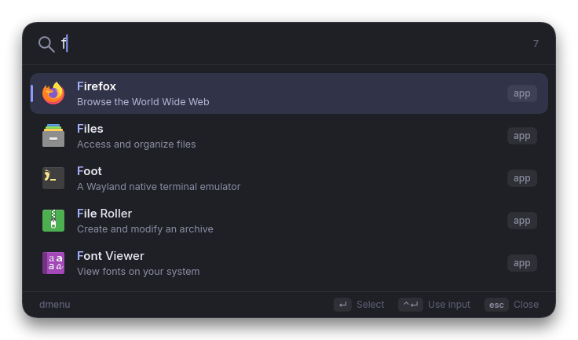
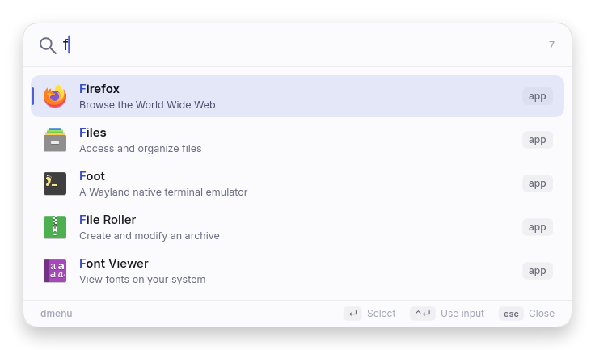

# doit

A rofi for the next millennium: a native Wayland launcher that speaks
structured items instead of strings.

<p>
   
</p>

- **Fast:** Rust, no toolkit, about 18 ms to the first frame.
- **Items, not lines:** titles, subtitles, icons, badges and actions as JSON.
  Plain lines still work, so it is a drop-in dmenu.
- **Live providers:** any executable can answer every keystroke. Bundled ones
  cover calc, a power menu, niri windows (with Alt+Tab), Melody music,
  Popcorn movies and Jot notes.
- **Looks good out of the box,** with fractional scaling, emoji, icon themes
  and four themes that follow your light or dark preference.

```sh
cargo build --release
install -Dm755 target/release/doit ~/.local/bin/doit
doit                  # apps
ls | doit             # dmenu
```

Needs a compositor with `wlr-layer-shell` (niri, sway, Hyprland, river, KDE,
COSMIC, …).

**[How it works →](docs/how-it-works.md)** Keys, flags, the item format, the
provider protocol, the bundled modes and theming.
